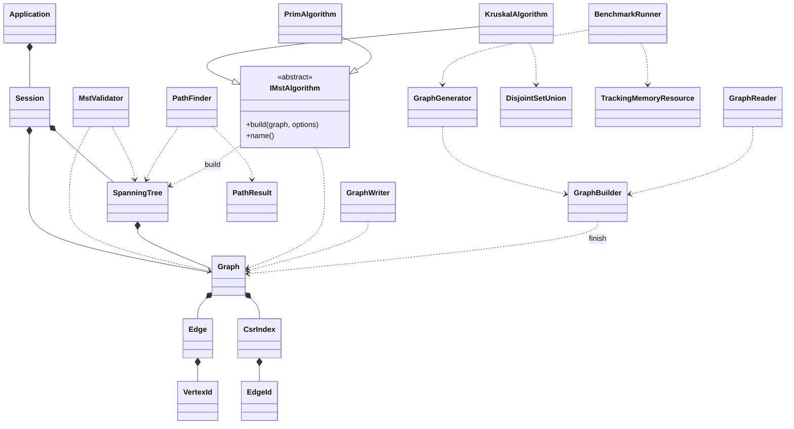

# Архитектура

`GraphBuilder<W>` проверяет размеры и рёбра, нормализует порядок концов и хранит множество уже добавленных пар. Обе перегрузки `add_edge` проходят через одну проверку. `GraphReader<W>` добавляет диагностику файла и строки, а `GraphWriter<W>` сохраняет номера от единицы и обратимо записывает вещественные веса.

`Graph<W>` владеет одним массивом рёбер и CSR-индексом из смещений и двух записей `EdgeId` на ребро. Методы, возвращающие `std::span<const T>` или ссылку, имеют lvalue-квалификатор. Представление действительно, пока владелец и его данные остаются на месте. `VertexId` и `EdgeId` содержат разные типы тегов, нумеруются с нуля и не преобразуются друг в друга.

`IMstAlgorithm<W>` задаёт интерфейс стратегии. Фабрика передаёт вызывающему `std::unique_ptr<IMstAlgorithm<W>>` с реализацией `PrimAlgorithm<W>` или `KruskalAlgorithm<W>`. Алгоритм читает граф через константную ссылку. Очередь, DSU, выборка рёбер и другие временные данные принадлежат одному вызову. `WeightType` ограничивает множество типов, а `WeightTraits` задаёт тип суммы и правила сравнения для каждого из них.

`SpanningTree<W>` создаётся после принятия `n − 1` рёбер. Оно владеет копиями выбранных рёбер в порядке принятия и собственным CSR-индексом. `PathFinder<W>` выполняет итеративный DFS, `PathResult<W>` владеет найденным маршрутом. `MstValidator<W>` принимает готовое дерево или независимо сформированного кандидата, поэтому его можно проверить заведомо ошибочными данными.

`Application` хранит текущий граф и дерево в варианте, зависящем от типа веса. CLI разбирает аргументы и отображает ошибки `std::expected`. `BenchmarkRunner` выполняет случаи с файловым источником или `GraphGenerator<W>`, который возвращает проверенный черновик для отдельного замера сборки CSR.

## Владение ресурсами

Рабочие PMR-контейнеры ссылаются на `BuildOptions::scratch`. Контейнеры результата ссылаются на `BuildOptions::storage`, который должен существовать до уничтожения дерева. Аналогичное правило действует для ресурса, переданного в `GraphBuilder::finish`. Ресурсы по умолчанию предоставляет стандартная библиотека. При копировании контейнеры выделяются из ресурса по умолчанию, а перемещение сохраняет исходный ресурс. Присваивание графа отключено, чтобы создание новой версии было явным и комплект рёбер с индексом менялся целиком.

Callback трассировки заимствует вызываемый объект на время `build` и вызывается синхронно. Событие передаётся как вариант `PrimStep<W>` или `KruskalStep<W>`. Прикладная часть принимает ожидаемые ошибки через `std::expected`. Подробности ошибки можно получить из `Error::origin` во внутренней диагностике.
